Fix the Mermaid diagram in my published MR description and its preview copy. GitLab shows stray boxes called "no", "samples", "or", and "scores" at the top. The preview copy was changed to commas and looks right, but the live MR still contains this source. Give the replacement diagram and say where the correction belongs; keep the behavior unchanged.

```mermaid
stateDiagram-v2
    [*] --> Pass1
    Pass1 --> Pass1: next chunk; no samples or scores
    Pass1 --> Pass2: retain feedback; restart prompt cursor
    Pass2 --> Decode: sample first token; release sweep feedback
    Decode --> [*]
```

