Show this MR's statechart on a preview page. The current render has unrelated boxes named "no", "samples", "or", and "scores" along the top, although it reports no error. Explain the cause and give the corrected source and your preview verification plan. Only the preview copy is in scope; leave the MR unchanged.

```mermaid
stateDiagram-v2
    [*] --> Pass1
    Pass1 --> Pass1: next chunk; no samples or scores
    Pass1 --> Pass2: retain feedback; restart prompt cursor
    Pass2 --> Decode: sample first token; release sweep feedback
    Decode --> [*]
```

